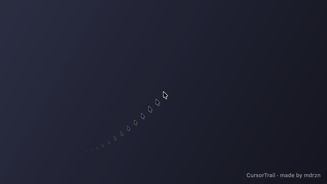
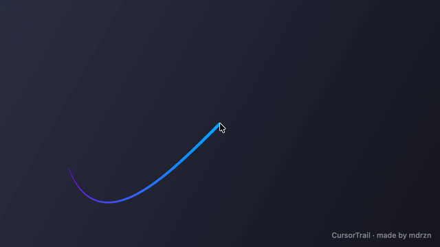
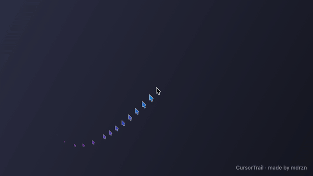
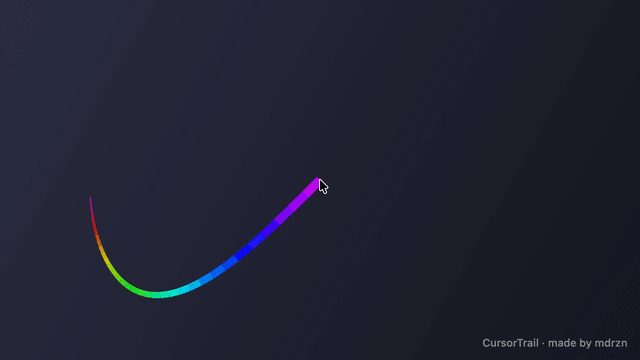

# CursorTrail

A lightweight cursor trail for macOS: a fading line or "ghost" copies of the pointer that follow your mouse.

| Ghosts | Line |
|---|---|
|  |  |
| **Tinted ghosts** | **Animated rainbow** |
|  |  |

## Features

- **Two styles:** a tapered gradient line, or faded copies of the cursor that shrink as they disappear.
- **Time-based or fixed-size trails**, with an optional inactivity timeout.
- **Head-to-tail lists** for width, opacity and size (e.g. `6,3,1`), any number of colors with adjustable blending.
- **Ghost recoloring:** keep the original colors, tint the inner fill only, the whole cursor, or one specific color.
- **Extras:** animated rainbow, minimum speed (trail only on fast flicks), 60/30 fps cap, X/Y offset.
- **Global hotkey** to toggle the trail (no Accessibility permission needed), with an on/off animation.
- **Menu bar app** with live settings window, launch at login, multi-monitor support.
- **Low overhead:** drawn with Core Animation layers, no full-screen redraws; it stops drawing when the mouse is still.

The settings UI is currently in Italian.

## Build & run

Requires macOS 14+ and the Xcode Command Line Tools (no Xcode project needed).

```sh
./build.sh            # builds CursorTrail.app
open CursorTrail.app  # icon appears in the menu bar
```

The demo GIFs are generated by the app itself, off-screen, with the same rendering engine:

```sh
./make-gifs.sh        # requires ffmpeg; writes docs/*.gif
```

## Limitations

- macOS does not let other apps read the current cursor shape reliably, so ghost copies always use the arrow.
- The trail is drawn in an overlay just below the real cursor.

## Credits

Made by [mdrzn](https://github.com/mdrzn).

Inspired by the [Cursor Trail](https://windhawk.net/mods/cursor-trail) mod for Windhawk by [Ulrizza](https://github.com/Ulrizza) (MIT). CursorTrail is an independent reimplementation for macOS; default values follow the original mod.

## License

MIT
